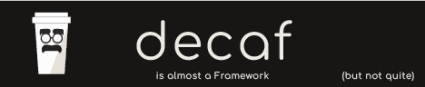

[](https://decaf-ts.github.io/for-testing/)
## @decaf-ts/for-testing

Testing toolkit for decaf-ts packages: evidence reporting, jest helpers, performance running and Xray/AgileTest teardowns, with a UI testing surface.


[](https://github.com/decaf-ts/for-testing/actions/workflows/nodejs-build-prod.yaml)
[](https://github.com/decaf-ts/for-testing/actions/workflows/codeql-analysis.yml)[](https://github.com/decaf-ts/for-testing/actions/workflows/snyk-analysis.yaml)
[](https://github.com/decaf-ts/for-testing/actions/workflows/pages.yaml)
[](https://github.com/decaf-ts/for-testing/actions/workflows/release-on-tag.yaml)


Documentation [here](https://decaf-ts.github.io/for-testing/), Test results [here](https://decaf-ts.github.io/for-testing/workdocs/reports/html/test-report.html) and Coverage [here](https://decaf-ts.github.io/for-testing/workdocs/reports/coverage/lcov-report/index.html)


### Description

`@decaf-ts/for-testing` is the testing toolkit for decaf-ts packages. It packages the
evidence and reporting pipeline that used to live under `@decaf-ts/utils/tests` into its own
repository so runtime packages no longer carry test-only code.

The backend toolkit is the default export of the package root:

- `TestReporter` — collects test evidence (messages, objects, tables, attachments) into a
  report storage directory (defaults via `TEST_REPORTER_STORAGE_ENABLED` /
  `TEST_REPORTER_STORAGE_PATH`).
- `ConsumerRunner` — consumer/producer orchestration: forks the producer child process,
  collects consumer and producer logs, and compares them (through `defaultComparer` or
  `reportingComparer`) to assert ordering and interleaving across forked processes.
- jest helpers (`itReportsOnFailure`, `ReportExpect`) — report failures and evidence directly
  from jest tests, backed by the reporter plumbing (`ensureReporterCollectsEvidencesConfig`,
  `setReporter` / `getReporter`, `reportObjects`) and `runAndReport` for command-execution
  evidence. Both are deprecated in favor of the reported-testing API below, but remain fully
  retrocompatible.
- reported-testing API — a jest-analog `it` facade (`it`, `it.skip`, `it.only`, `it.todo`,
  `it.each`, `it.concurrent`, plus `it.report(...)` with `.skip` / `.only` / `.each` for
  evidence-reporting tests) and a framework-agnostic chainable `expect(actual)
  .referredToAs(label).to.*` assertion facade (also available as the reporter-scoped
  `TestReporter#expect`). Registration and assertions are proxied to the host test runner
  through framework adapters for jest, vitest and Playwright, selected via
  `configure({ framework })`, the `DECAF_TEST_FRAMEWORK` environment variable or runner
  environment sniffing.
- `JestPerformanceRunner` — runs performance scenarios and reports phase tables and charts.
- post-test import pipeline — `runJestXrayTeardown` / `runJestAgileTestTeardown` convert the
  JUnit report and evidence directories into Xray and AgileTest import payloads, and the decaf
  CLI module exposes the same engine as `decaf test report xray|agiletest`; the Xray teardown
  is gated by `ENABLE_XRAY_REPORT`, the AgileTest payload is always written locally, and
  uploads only happen when the respective credentials are configured.

UI-specific helpers are grouped under the `ui` namespace, exported both as the `ui` named
export of the package root and as the `@decaf-ts/for-testing/ui` subpath. No UI helpers exist
yet, so that surface is intentionally minimal but stable for future browser and component helpers.

```typescript
// backend toolkit (default)
import { TestReporter, itReportsOnFailure } from "@decaf-ts/for-testing";

// UI toolkit (named namespace)
import { ui } from "@decaf-ts/for-testing";
import * as ui from "@decaf-ts/for-testing/ui";
```

#### Migrating from `@decaf-ts/utils/tests`

`@decaf-ts/utils/tests` remains published, so nothing forces an immediate migration. When you are ready:

1. Install the new package (`npm install --save-dev @decaf-ts/for-testing`) and rewrite the
   imports: `@decaf-ts/utils/tests` → `@decaf-ts/for-testing`. The backend export surface
   (`TestReporter`, the jest helpers, `ConsumerRunner`-based orchestration, the performance
   runner and the teardowns) is unchanged — only the import path moved.
2. Optionally adopt the new surfaces this package adds: the `ui` namespace and
   `@decaf-ts/for-testing/ui` subpath (reserved, currently empty but stable), the
   `VERSION` / `COMMIT` / `FULL_VERSION` / `PACKAGE_NAME` build constants, and the
   reported-testing API (`it` / `it.report`, `expect`) described above. The same reported
   API is backported verbatim into the `@decaf-ts/utils/tests` subpath; that subpath carries
   no `utils -> testing` dependency edge, and `@decaf-ts/for-testing` additionally provides
   the provider teardowns and the `decaf test report` CLI.


### How to Use

- [Installation](#installation)
- [Backend toolkit examples](#backend-toolkit-examples)
- [UI toolkit surface](#ui-toolkit-surface)
- [Initial Setup](./workdocs/tutorials/For%20Developers.md#_initial-setup_)
- [Installation](./workdocs/tutorials/For%20Developers.md#installation)
- [Scripts](./workdocs/tutorials/For%20Developers.md#scripts)
- [Linting](./workdocs/tutorials/For%20Developers.md#testing)
- [CI/CD](./workdocs/tutorials/For%20Developers.md#continuous-integrationdeployment)
- [Publishing](./workdocs/tutorials/For%20Developers.md#publishing)
- [Structure](./workdocs/tutorials/For%20Developers.md#repository-structure)
- [IDE Integrations](./workdocs/tutorials/For%20Developers.md#ide-integrations)
  - [VSCode(ium)](./workdocs/tutorials/For%20Developers.md#visual-studio-code-vscode)
  - [WebStorm](./workdocs/tutorials/For%20Developers.md#webstorm)
- [Considerations](./workdocs/tutorials/For%20Developers.md#considerations)

#### Installation

```sh
npm install --save-dev @decaf-ts/for-testing
```

Requires Node >= 20 and npm >= 10. The package ships ESM and CJS builds from the package root,
plus the `./ui` subpath for the UI testing surface.

The reporting integrations `jest-html-reporters`, `json2md` and `chartjs-node-canvas` are
declared as optional peer dependencies: they are only needed when you use the corresponding
reporter features (HTML evidence rendering, markdown tables, charts). When a feature runs
without its dependency available, the reporter installs it on demand at runtime, so a plain
install works without pre-declaring anything.

#### Backend toolkit examples

##### Evidence reporting in jest

Install the test-scoped reporter once, typically in a jest setup file:

```typescript
import {
  TestReporter,
  ensureReporterCollectsEvidencesConfig,
  setReporter,
} from "@decaf-ts/for-testing";

await ensureReporterCollectsEvidencesConfig();
setReporter(new TestReporter());
```

`ensureReporterCollectsEvidencesConfig` defaults `TEST_REPORTER_STORAGE_ENABLED` and
`TEST_REPORTER_STORAGE_PATH`, so evidence collection is on for tests using the jest helpers.

Then report failures and chained assertions from your tests:

```typescript
import {
  itReportsOnFailure,
  ReportExpect,
  getReporter,
  reportObjects,
} from "@decaf-ts/for-testing";

itReportsOnFailure("creates a resource", async () => {
  const response = await fetch("https://example.org/api/resource", { method: "POST" });

  const report = new ReportExpect();
  report.assertToBe(200, response.status, "status");
  report.assertToContain(await response.text(), "created", "body");

  await reportObjects(getReporter(), report, response);
});
```

`itReportsOnFailure` persists the failure `message` and `cause` through the test-scoped
reporter before rethrowing; `reportObjects` writes the response and the accumulated report
and throws when the chain carries failed assertions.

When evidence storage is enabled, reported evidence file names are derived from the
`reference` argument and sanitized: the reference is reduced to its base name, any character
outside `A-Za-z0-9._-` is replaced with `-`, and leading dots and dashes are stripped. Evidence
is always written inside the configured evidence root — a reference that would resolve outside
it is refused with an error.

##### Reported tests with `it` and `it.report`

The package exports a jest-analog `it` facade. Plain registrations proxy straight to the host
framework's own `it`/`test` primitives, so `it`, `it.skip`, `it.only`, `it.todo`, `it.each` and
`it.concurrent` behave exactly like the runner you are using:

```typescript
import { it } from "@decaf-ts/for-testing";

it("registers with the host runner", () => {
  /* ... */
});
it.skip("skipped", () => {
  /* ... */
});
it.only("focused", () => {
  /* ... */
});
it.todo("not written yet");
```

`it.report(name, fn, opts?)` registers an evidence-reporting test: when the handler throws, its
`message` and `cause` are persisted through the test-scoped reporter before the error is
rethrown, so the failure still shows up in the evidence report. The optional options object
accepts `reporter` (defaults to `getReporter()`) and `timeout` (forwarded to the framework when
supported):

```typescript
it.report("creates a resource", async () => {
  const response = await fetch("https://example.org/api/resource", { method: "POST" });
  // assertions accumulate through `expect` (next section)
});

it.report.skip("skipped reported test", () => {
  /* ... */
});
it.report.only("focused reported test", () => {
  /* ... */
});
```

`it.report.each` runs one evidence-reporting test per table row, in both the array form and the
tagged-template table form. In the tagged form the table headings become named row fields
(addressable as `$field` or a dotted `$row.field` path) and `$#` expands to the 1-based row
index:

```typescript
it.report.each([1, 2])("handles %d", (n: number) => {
  expect(n).referredToAs("value").to.beDefined();
});

it.report.each`
  value | expected
  ${1}  | ${2}
  ${3}  | ${4}
`("doubles $value", ({ value, expected }: { value: number; expected: number }) => {
  expect(value * 2).referredToAs("doubled").to.be(expected);
});
```

> [!TIP]
> The legacy `itReportsOnFailure(name, handler, skip?)` helper still works but is deprecated;
> it is now a thin wrapper over `it.report(name, fn)` / `it.report.skip(name, fn)`. Prefer the
> new surface.

##### Assertions with `expect`

`expect(actual)` builds a chainable, framework-agnostic assertion facade:

```typescript
import { expect, getReporter, reportObjects } from "@decaf-ts/for-testing";

expect(response.status).referredToAs("status").to.be(200);
expect(body).referredToAs("body").to.contain("created");
expect(errors).referredToAs("no errors").not.to.beTruthy();

const reporter = getReporter();
await reportObjects(reporter, reporter.expect, response);
```

Supported matchers: `to.be`, `to.equal`, `to.contain`, `to.beGreaterThan`,
`to.beGreaterThanOrEqual`, `to.beLessThan`, `to.beLessThanOrEqual`, `to.beDefined` and
`to.beTruthy`. `.not` negates only the next matcher. Like the legacy chain accumulator, each
matcher records one report line and one failure entry instead of aborting the test, and the
underlying assertion runs through the host framework's own `expect`, so failure semantics match
the runner.

Two accumulator scopes share the same API:

- `TestReporter#expect` — a reporter-scoped facade; every assertion made through one reporter
  instance accumulates on a single report owned by that reporter.
- the standalone `expect` export — reuses the `expect` facade of the reporter installed through
  `setReporter` when there is one, otherwise falls back to a shared standalone accumulator.

Accumulated assertions are persisted with `reportObjects(reporter, reporter.expect, response)`,
which writes the response and report objects and throws when the report carries failed
assertions.

> [!TIP]
> The legacy `ReportExpect` chain (`assertToBe`, `assertToContain`, ...) still works but is
> deprecated; `expect(actual).referredToAs("property").to.*` replaces it.

##### Framework adapters

The reported API resolves a framework adapter that proxies registration and assertions to the
host runner. Selection order:

1. `configure({ framework: "jest" | "vitest" | "playwright" })` — explicit, process-wide
2. `DECAF_TEST_FRAMEWORK=jest|vitest|playwright` environment variable
3. sniffed runner environment (`JEST_WORKER_ID`, `VITEST`/`VITEST_WORKSPACE_ID`/`VITEST_MODE`,
   `PLAYWRIGHT_TEST`/`PLAYWRIGHT_TEST_BASE_URL`/`PLAYWRIGHT_BROWSERS_PATH`)
4. otherwise jest, then vitest, then playwright, until one resolves

The resolved adapter is cached process-wide (`resetAdapter()` clears it); when nothing
resolves, the error names both override knobs. The vitest adapter additionally requires vitest
to be installed or `globals: true` in the vitest config, and the Playwright adapter requires
`@playwright/test`. Deviations per framework:

| Capability | jest | vitest | playwright |
| ---------- | ---- | ------ | ---------- |
| `it` / `it.skip` / `it.only` / `it.todo` | full | full | `todo` maps to `test.fixme` |
| `it.each` | full | full | not available (descriptive error) |
| `it.report.each` (array and tagged-table form) | full | full | full |
| `it.concurrent` | full | full | not available |
| `timeout` forwarded to the runner | yes | yes | no (Playwright configures timeouts itself) |

##### Xray / AgileTest report import via the CLI

The decaf CLI module exposes the same post-test importer as the programmatic teardowns:

```sh
decaf test report xray --junit workdocs/reports/junit/junit-report.xml --upload
decaf test report agiletest --dry-run
```

Options for `decaf test report <xray|agiletest> [--options]`:

| Option                 | Purpose                              | Default when omitted                                                                                            |
| ---------------------- | ------------------------------------ | --------------------------------------------------------------------------------------------------------------- |
| `--junit <path>`       | JUnit XML report path                | `JUNIT_PATH` env, else `workdocs/reports/junit/junit-report.xml`                                                 |
| `--evidences <dir>`    | evidence root directory              | `ASSETS__PATH` env, else `TEST_REPORTER_STORAGE_PATH`, else `workdocs/reports/evidences`                          |
| `--out <file>`         | payload output file                  | `workdocs/reports/evidences/tests/xray.json` / `agiletest.json`                                                   |
| `--execution-key <key>`| provider Test Execution issue key    | `XRAY_TEST_EXECUTION_KEY` (xray) / `AGILETEST_TEST_EXECUTION_KEY` (agiletest), else `TEST_EXECUTION_KEY`           |
| `--dry-run`            | parse only; nothing is written or uploaded | off                                                                                                         |
| `--upload`             | upload the generated payload to the provider | off                                                                                                       |

Upload credentials are read from the environment: Xray needs `XRAY_CLIENT_ID` and
`XRAY_CLIENT_SECRET` (they also drive the preconditions synchronization after an upload);
AgileTest needs `AGILETEST_HOST`, `AGILETEST_EMAIL` and `AGILETEST_API_TOKEN` (optional
`AGILETEST_BASE_PATH`, default `/rest/agiletest/1.0`, and `AGILETEST_IMPORT_PATH`, default
`/test/import`). Missing credentials skip the upload with a warning; the payload is still
written locally.

##### Consumer/producer orchestration

```typescript
import { ConsumerRunner, defaultComparer } from "@decaf-ts/for-testing";

const runner = new ConsumerRunner(
  "create",
  async (identifier: number) => {
    // consume one producer iteration
    return "";
  },
  defaultComparer
);

const result = await runner.run(5, 100, 5, true);
```

`ConsumerRunner` forks the producer child process, collects the producer and consumer logs,
and resolves with a `ComparerResult` holding both parsed log sets for the comparison.

##### Xray / AgileTest teardown

```typescript
import { runJestXrayTeardown, runJestAgileTestTeardown } from "@decaf-ts/for-testing";

// Xray: the teardown only runs when ENABLE_XRAY_REPORT === "true"
process.env.ENABLE_XRAY_REPORT = "true";
await runJestXrayTeardown();

// AgileTest: the upload is skipped without AGILETEST_HOST/AGILETEST_EMAIL/AGILETEST_API_TOKEN
await runJestAgileTestTeardown();
```

Both teardowns read the JUnit report (`JUNIT_PATH`) and the evidence root
(`ASSETS__PATH`/`TEST_REPORTER_STORAGE_PATH`), and always write the import payload locally
(`workdocs/reports/evidences/tests/xray.json` / `agiletest.json`); the upload only happens
when the respective credentials are configured.

#### UI toolkit surface

```typescript
import { ui } from "@decaf-ts/for-testing";
import * as ui from "@decaf-ts/for-testing/ui";
```

Both import paths resolve to the same module. No UI helpers exist yet; the surface is stable,
so helpers added later become available through both paths without a breaking change.


### Related

[](https://github.com/decaf-ts/for-testing)
[](https://github.com/decaf-ts/utils)


### Social

[](https://www.linkedin.com/in/TiagoVenceslau/)


#### Languages


## Getting help

If you have bug reports, questions or suggestions, please [create a new issue](https://github.com/decaf-ts/for-testing/issues/new/choose).

## Contributing

I am grateful for any contributions made to this project. Please read [this](./workdocs/98-Contributing.md) to get started.

## Supporting

The first and easiest way you can support it is by [Contributing](./workdocs/tutorials/Contributing.md). Even just finding a typo in the documentation is important.

Financial support is always welcome and helps keep both me and the project alive and healthy.

So if you can, if this project in any way. either by learning something or simply by helping you save precious time, please consider donating.

## License

This project is released under the [MIT License](./LICENSE.md).

By developers, for developers...